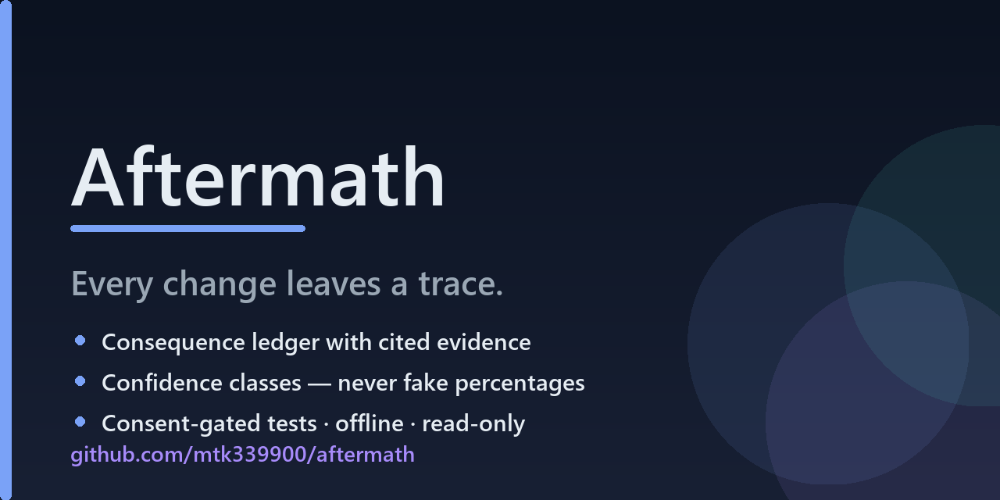

# Aftermath

> **Every change leaves a trace.**

<p align="center">
  
  
  
  
  
</p>

Aftermath reads your Git change, resolves what it touches with **structural evidence**, and is explicit about what it *cannot* see. It is local-first, offline by default, read-only with respect to your source, and it never fabricates certainty.

It answers four questions a diff alone does not:

- **What does this change touch?** — a consequence ledger of affected symbols, each with the exact evidence that connects it.
- **What don't I know?** — a first-class *unknowns* report; absence of discovered coverage is never presented as proof of safety.
- **What should I test now?** — structural, counterfactual test suggestions.
- **Did anything actually verify?** — tests are run only with explicit consent, and their status is one of four honest states, never an implied "passing".

---

## Why

Most "impact analysis" tools guess. They print a confidence *percentage* that is theater, they blithely equate "I found nothing" with "it's safe", and they run your test suite behind your back. Aftermath is built on the opposite contract:

> **Evidence before speculation. Uncertainty is a first-class output, not a failure to hide.**

Every finding cites where in your code it came from. Every confidence label is a small, documented class (`confirmed_relationship`, `possible_impact`, `unknown`, …), never a fabricated number. Every limitation — an unsupported language, an unresolvable dynamic import, a binary file, a `eval()` — is reported as a **blind spot** rather than silently skipped.

## Install

Aftermath is a single Rust binary with no runtime daemon, no network calls, and no telemetry. Build it from source:

```sh
cargo build --release
# the binary is at target/release/aftermath
```

Then make sure the project is versioned (Aftermath reads Git, via the [libgit2](https://github.com/rust-lang/git2-rs) library — it never shells out to `git`):

```sh
cd your-repo
aftermath init            # writes an aftermath.toml and .aftermath/ (gitignored)
```

## Try it

Make a change, then:

```sh
aftermath inspect         # the consequence ledger for your working-tree change
aftermath inspect --staged
aftermath inspect --revision HEAD~1
```

A trimmed example of the terminal output:

```
Aftermath — change consequence ledger
  aftermath 0.1.0 · worktree change · 1 file(s) · 2026-10-14T05:11:42Z
  revision 23753660c995 (uncommitted changes present)

Summary
  1 file · 1 symbol(s) · 3 affected · 2 unknown · 1 blind spot(s) · 2 test(s)

What changed and what it touches
  src/parse.ts::parseConfig [confirmed relationship]
    change: modified — parseConfig (function)
    changed lines: 3
    → calls src/app.ts::load [confirmed relationship]
    → imports src/app.ts::parseConfig [confirmed relationship]
    → calls tests/parse.test.js::parseConfig (call site) [possible impact]

What we don't know
  • `tests/parse.test.js::parseConfig (call site)` may be affected, but the link is a
    name match that could not be resolved to a declaration
    next → confirm whether this reference resolves to the changed symbol
  • tests were identified but not executed (no consent given)
    ...
```

Notice what is *not* there: no percentage, no "98% confidence you're safe". It says what it found, cites each link, and names the two things it could not establish.

## 30-second demo

<p align="center">
  <a href="media/aftermath-intro.mp4" title="Watch the Aftermath intro (40s, muted)">
    
  </a>
</p>

<p align="center">
  <a href="media/aftermath-intro.mp4">▶ Watch the 40-second intro (MP4)</a> ·
  authored in HTML (<a href="media/intro.html">media/intro.html</a>), no audio.
</p>

## How it works

Aftermath never runs your tests or touches your code. It reads the diff, parses the
code, and resolves references — then separates what it proved from what it couldn't.

```
 git diff ─┐
           ├─► parse (tree-sitter) ─► resolve imports ─► impact engine
 staged ───┤                                              │
           │                          ┌───────────────────┘
           ▼                          ▼
   changed symbols ──────► affected symbols, each with:
                             • a relationship (calls / imports / extends / type)
                             • a confidence class (never a %)
                             • the exact file:line evidence
                                    │
                                    ▼
                       what we don't know + blind spots + suggested tests
```

The whole pipeline is deterministic and offline: same change in, same report out
(only the timestamp differs), which is what makes `aftermath inspect --baseline`
diffs meaningful.

## Commands

| Command | What it does |
|---|---|
| `aftermath init` | Write `aftermath.toml` (or `--force` to overwrite) and `.aftermath/`; `--git` also initializes a repository. |
| `aftermath inspect [--staged] [--revision REV] [--baseline FILE] [--file PATH]` | The consequence ledger. `--baseline` diffs against a previously saved report. |
| `aftermath why <symbol>` | Deep-dive one changed symbol: its affected symbols, evidence, and suggestions. |
| `aftermath gaps` | Everything the analysis could **not** prove: unknowns + blind spots. |
| `aftermath verify [--run-tests]` | The verification state. Tests run **only** with `--run-tests`. |
| `aftermath report --format json\|markdown\|terminal [--out FILE]` | Emit the full deterministic report. |
| `aftermath history [--file PATH] [--limit N]` | Repository archaeology: file co-change across commits (correlation, never proof). |
| `aftermath watch` / `aftermath watch --remove` | Install/remove the advisory `pre-commit` change-witness hook. |
| `aftermath doctor` | Check the environment: Git, config, cache, optional `node` runner. |
| `aftermath schema [--out FILE]` | Print the JSON Schema for reports. |

Every command accepts the shared flags `--json`, `--no-color`, `--quiet`/`--q`, `--verbose`/`-v`, `-C/--repo PATH`, `--config PATH`, and `--offline`.

### Exit codes

`0` success · `1` runtime error · `2` usage error · `3` not a Git repository · `4` not found (unknown symbol, missing baseline).

## The evidence model (in 30 seconds)

- **Confidence is classified, never numeric.** `confirmed_relationship` means a *resolved* link (a call to a declared/imported symbol, or a diff hunk over the declaration). `possible_impact` means a *plausible but unproven* match (a name with no structural link, a member call we cannot attribute without type info). `unknown` means resolution was blocked — which says nothing about whether a relationship exists. See [docs/EVIDENCE_MODEL.md](docs/EVIDENCE_MODEL.md).
- **Test status has four states, kept honest.** `passed`, `failed`, `not_executed`, `unavailable`. A tool that did not run a test can never report it as passing.
- **Blind spots are reported, not hidden.** Unsupported languages, unresolved/dynamic imports, `eval()`, binary or oversized files, generated code — each becomes an explicit entry.

Full details: [docs/EVIDENCE_MODEL.md](docs/EVIDENCE_MODEL.md). Honest scope and known limits: [docs/LIMITATIONS.md](docs/LIMITATIONS.md).

## Safety, by contract

- **Read-only.** Aftermath never modifies your source. The only thing it writes is its own disposable cache in `.aftermath/` (safe to delete; add it to `.gitignore`).
- **No shell.** When it runs a test, it spawns a program with an argv array — there is no string interpolation into a shell, so a filename is just a filename.
- **Consent.** Tests are executed only when you ask (`verify --run-tests`). Nothing runs in the background.
- **Offline.** Aftermath makes no network calls. `cargo build` fetches dependencies; the tool itself does not.
- **Redaction.** Credential-shaped strings and absolute machine paths are redacted from anything that lands in a report.

See [SECURITY.md](SECURITY.md).

## Language support

TypeScript and JavaScript first (`.ts`, `.tsx`, `.js`, `.jsx`, `.mjs`, `.cjs`), via [tree-sitter](https://tree-sitter.github.io/). The language layer is a trait (`LanguageAdapter`), so adding a language means adding an adapter, not changing the evidence model. Other languages present in a repo are reported as blind spots, not ignored silently.

## Documentation

- [docs/ARCHITECTURE.md](docs/ARCHITECTURE.md) — how the crates and pipeline fit together.
- [docs/EVIDENCE_MODEL.md](docs/EVIDENCE_MODEL.md) — confidence classes, the four test states, what each means.
- [docs/LIMITATIONS.md](docs/LIMITATIONS.md) — exactly what Aftermath does not do.
- [CONTRIBUTING.md](CONTRIBUTING.md) — how to build, test, and add a language.
- [SECURITY.md](SECURITY.md) — what Aftermath protects, and how to report issues.
- [CHANGELOG.md](CHANGELOG.md).

## Roadmap

Aftermath is **v0.1.0** and deliberately honest about that. Current state and what's next:

- ✅ TypeScript/JavaScript impact analysis, unknowns, blind spots, suggestions
- ✅ Consent-gated test execution, reproducible reports, JSON Schema, evidence diff
- 🚧 More languages via the `LanguageAdapter` trait (Python, Go, Rust — adapters welcome)
- 🚧 Deeper cross-package resolution for monorepos/workspaces
- 🚧 GitHub Action for PR-time consequence checks

Want to steer it? Issues and PRs are the roadmap. Look for [`good first issue`](https://github.com/mtk339900/aftermath/labels/good%20first%20issue).

## Contributing & support

- ⭐ **Star the repo** if the "evidence over theater" approach resonates — it genuinely helps others find it.
- 🐛 Found a false claim or a crash? That's the highest-priority bug class here — [open an issue](https://github.com/mtk339900/aftermath/issues/new/choose).
- 🌍 Add a language adapter, or pick a [`good first issue`](https://github.com/mtk339900/aftermath/labels/good%20first%20issue). See [CONTRIBUTING.md](CONTRIBUTING.md).

## License

Dual-licensed under either of

- Apache License, Version 2.0 ([LICENSE-APACHE](LICENSE-APACHE))
- MIT License ([LICENSE-MIT](LICENSE-MIT))

at your option.

---

<sub>Made for developers who want to know what their change *actually* reaches — and to be told, plainly, when the truth is "we can't see that from here."</sub>
